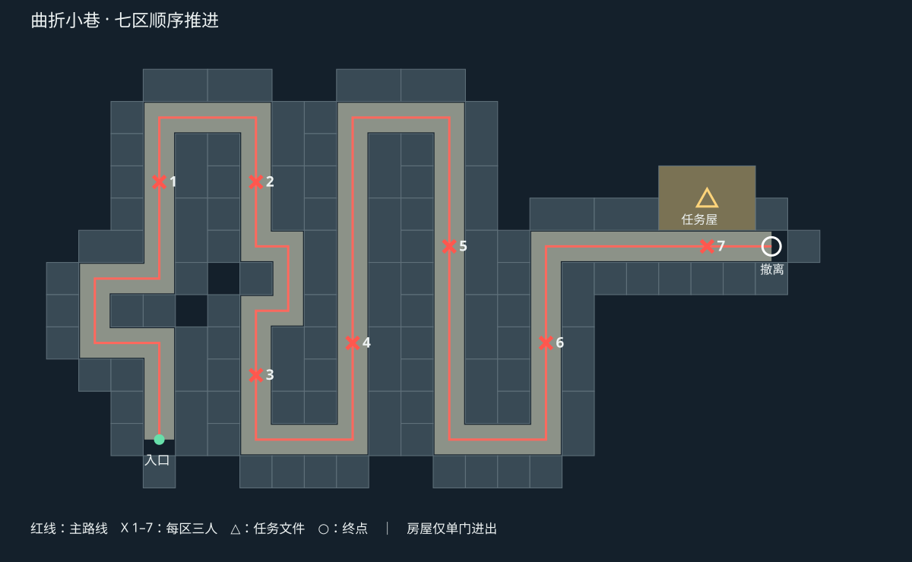

# 曲折小巷关卡

2026-10-03，按用户标注的蛇形红线路线改建 `assets/Demo01.ls`，最初在 `codex/fix-enemy-perception` 工作区开发。2026-10-11 按用户确认，将完整小巷版本和 `codex/fix-door-interaction` 的门交互修复一并整合到 master，沿用侧后方感知修复与五名队友。

## 地图与任务

入口在左下方，先经过折返小巷，再沿多条纵向街巷交替推进，最后转入右侧横向通道。沿路是独立的单门房屋，F 开门后可双向出入；透明窗关闭时可观察，F 开窗后可射击。窗洞高度 0.85 米，不构成角色穿越通道。房屋背墙和侧墙阻止抄近路。第三波前增加短折返，防止与第二波区域形成一条贯通视线。

当前主路长约 568 米，采用 8 米街道网格，包含 94 栋普通房屋和一栋较大的任务屋。门、窗、屋顶、家具和地面使用已有原创砖墙、抹灰、木材、瓦片及铺地贴图。静态模型按房屋和材质合批，增加内饰后使用 2,514 个固定碰撞盒体，另有 285 个随门窗转动的叶片碰撞体。旧松柏巷模型保留，当前场景不再加载它们。

| 区域 | X 点世界坐标（X/Z） | 玩家接近触发点（X/Z） |
| --- | --- | --- |
| 1 | -48 / -24 | -64 / 8 |
| 2 | -24 / -24 | -40 / -40 |
| 3 | -24 / 24 | -24 / -8 |
| 4 | 0 / 16 | -8 / 40 |
| 5 | 24 / -8 | 8 / -40 |
| 6 | 48 / 16 | 40 / 40 |
| 7 | 88 / -8 | 48 / 0 |

每区三名敌人，出生前保持未激活。玩家进入 4 米触发范围且上一波全灭后才激活本波，队友不能触发后续波次。触发点与出生点之间有建筑遮挡。各波敌人只使用本区的巡逻点，巡逻半径 6 米，包含战斗移动在内的活动范围限制在 X 点周围 10 米。

区域归属按主路线投影后的行进距离判断，避免隔墙相邻的平行街道共用警戒区。枪声只通知同区、40 米以内且已激活的角色，保留开枪位置快照；旧的全图警戒与呼叫增援流程不用于本关。队友根据自身沿路线的进度持续前进，目标限制在当前交战区或下一入口的集合点。每波清空后取消旧战斗记忆及枪声搜索，立即继续向下一入口推进。队友只攻击已经触发的当前波次，不能自行触发后续波次；进入下一波仍由玩家决定。

全部七波清除后，到任务屋内 `(88, 1.04, -22)` 的桌上按 F 取得文件，再进入 `(104, 1, -8)` 的白色撤离圈。未取文件不能通关；暂停不推进波次，重新开始恢复未激活的七波敌人和任务物品。

## 编辑与生成

- `src/EncounterWave.ts`：每波敌人、接近触发点、区域范围。
- `src/MissionRoute.ts`：主路线距离投影和队友跟随位置。
- `src/LevelController.ts`：顺序激活、区域枪声、任务 HUD；无波次配置时继续支持原系统测试场。
- `src/EnemyAI.ts`：可选区域活动边界、目标区域过滤和队友跟随点。
- `tools/build-lane-mission.py`：生成模型、布局和场景补丁。
- `source-assets/level-kits/lane-enemy-template.json`：固定敌人模板，包含模型、枪口和反馈节点。

生成脚本只输出模型、`output/lane-mission/layout.json` 与 `scene-patch.json`，不直接覆盖 `.ls`。场景补丁通过 Laya IDE `Laya_EditAsset` 应用并校验。重新生成后的节点数据与保存场景一致。旧版 `configure-squad.py` / `configure-search-reinforcements.py` 为历史地图脚本，不用于本关重建。

LayaAir 3.4.1 在运行预览时整批替换场景节点，可能保留失效编辑器实例，并导出仅含版本号的空缓存。本次通过完整退出并重新打开编辑器恢复；源场景一直完整。后续整批改图应先停止预览，确认场景加载完成后再启动，必要时重新打开编辑器；不要把空预览缓存反写成源文件。

## 验证

- **PASS**：全项目 TypeScript 编译、场景引用与重复 ID 检查、场景补丁 Schema 校验、`git diff --check`。
- **PASS**：13 组 AI/寻路/输入回归，保留侧后方视野限制。
- **PASS**：9 组任务回归与实际预览缓存绑定比对；旧 `Scene.ls` 的任务模式仍通过检查。
- **PASS**：`tools/check-lane-mission-runtime.js` 的 137 项真实引擎检查：开局 8 秒没有激活敌人且生命保持 100；18 段主路可通行；抽查两栋普通房屋及任务屋的门窗；七波的顺序、暂停、遮挡出生、局部巡逻、区域枪声、死亡计数；取文件、撤离和重开。
- **PASS**：独立真实交火检查。五名队友在 4 秒内分别跟随移动约 6.04、6.04、5.62、5.62、5.37 米；首波 5 秒内发生 5 次敌方开火并造成 72 点伤害；仅三名敌人激活，均在本区活动边界内。
- **PASS**：最终坡屋顶模型及纯白撤离圈已重新加载并截取俯视画面。

波次流程测试通过运行时摆位和调用真实伤害入口加速清敌；交火测试临时提高玩家生命，测试结束刷新还原。以上不等于完整手动实战通关，也未据此确认最终难度、弹药消耗或不同机器上的性能平衡。

### 开局主动探路调整

以下为前一版的调整记录；当前版本进一步改为分区自推进，见下节。

此前队形目标在玩家身后，站在出生点时队友会原地待命。现改为沿路线前出并在附近巡逻。后排第五名队友采用外侧路线；角色避让在首选侧被挡时尝试另一侧，避免被静止玩家挡住后持续选择同一个受阻方向，两侧仍使用原生碰撞检查。

真实按键验证：玩家静止 3.5 秒，五人分别移动约 4.34、5.50、6.08、6.61、11.30 米；8 秒时五人均已处于玩家前方，后续巡逻点继续变化，未激活敌人。按 W 前进后巡逻区域前移；按 Esc 后游戏时钟和五人的位置均冻结。AI/导航/输入回归增加双侧避让检查，目前共 14 组。

### 清区后推进与建筑闪烁修复

原先队形目标仍以玩家位置为中心，因此玩家留在原地时，打完一波的队友会碰到推进距离上限；旧枪声还会保持最多 20 秒搜索状态。现在根据每名队友自身路线进度设置下一段目标，并在清区时通过 `resumePatrol()` 清除已失效的目标、掩体、枪声与路径缓存。集合点设在下一区入口前，防止自动连续开战。

建筑闪烁来自盒体接缝、屋顶等同朝向共面几何的重复覆盖。生成器对同一平面的矩形做面积裁剪，保留原始纹理坐标；仅删除重复覆盖的渲染面，不改变物理碰撞体。屋面装饰条也留出明确间距，避免紧贴坡面。`tools/check-lane-surfaces.py` 直接检查输出 GLB，旧模型检测到 5,197 处共面重叠，修复后 25,145 个受检面中重叠数为 0。

验证：`tools/check-squad-wave-transition-runtime.js` 中玩家留在第一波后方不动，五人在 7.5 秒内沿路线前进约 15.75、15.44、16.55、23.77、24.08 米，在下一入口前集合；第二波保持未激活，玩家到达后才触发。AI/导航/输入回归增至 15 组。另对修复后的模型做了相同视点及 0.05 度转动的画面对照，检查屋顶接缝表现。道路、门窗与场景碰撞数据保持一致。

### 第四区接敌、减速与房间内饰

第四区原出生中心距 `(0,40)` 转角约 64 米，超过双方 35 米视距。在 `(0,35)` 定点复现时，距离第一名敌人约 59.03 米，AI 确实无法发现目标。现将本区出生中心、三名敌人、巡逻点和附近掩体统一前移到 `(0,16)` 周围，原触发点不变。复测该位置距离敌人约 19.09 米，双方可见且进入战斗，4.5 秒内各开火 3 次；刷新仍由建筑遮挡。

玩家疾跑从 9 降至 6.5 米/秒，队友为 6 米/秒，敌人为 4.5 米/秒；正常步行不变。`tools/check-fourth-area-runtime.js` 使用真实按键检查疾跑，1 秒约移动 6.43 米，并执行上述双方交火验证。

普通房间采用六种用途布局：卧室、餐室、储物间、工作间各 16 间，书房与会客间各 15 间；任务屋为档案室。家具优先布置在侧边及后墙，保留中央通路，包括床及枕垫、餐桌和凳子、柜架与书本、堆放箱、工作台与工具、长凳及少量顶梁。

原生物理逐间检查通过：95 个门口至室内中心的路径、94 条普通房间中心至后方的通道、190 个窗户射线开口。更新模型的 31,925 个受检面中仍为 0 处共面重叠。137 项关卡流程、15 组 AI/导航/输入回归、9 组任务与预览绑定检查及 TypeScript 编译通过。

### F 开关门窗

`src/Openable.ts` 管理 95 扇木门和 190 扇透明玻璃窗。叶片向室内绕铰链打开 95 度，速度为 160 度/秒。房门交互跟随门板当前的位置与角度，开门后须瞄准实际门板关闭，原来的空门洞不再触发房门；窗户仍沿用固定开口平面的交互方式。2.8 米内瞄准后按 F 切换，屏幕显示“打开/关闭房门/窗户”。门窗默认关闭，重载场景后恢复；暂停及结算冻结动作。动画每步检查人物是否挡住旋转位置，受阻时等待，移开后继续，不强行穿过角色。

`LevelController` 统一处理 F：可拾取的任务文件优先，其次是准星命中的最近门窗；超距、遮挡、暂停及长按重复均不会误触发。玻璃使用真正的透明混合材质（透明队列、关闭深度写入），AI 观察射线可穿过玻璃；关闭的窗扇阻挡人物和子弹，打开后窗口可以射击。

`tools/openable_panels.py` 生成可复用的门窗叶片 GLB，`tools/build-lane-mission.py` 为每栋房屋生成铰链、碰撞和交互组件。静态建筑模型与原有开口保持不变。

此前 `tools/check-openables-runtime.js` 的 20 项原生检查通过：数量和初始状态、透明材质、真实 F 键、长按、门的通行阻挡、内外开关窗、玻璃视线/弹道区别、暂停及恢复、防夹与复位。137 项关卡回归在打开门窗的几何测试条件下通过，包含任务文件拾取、通关和重开；15 组 AI/输入、9 组任务/预览绑定回归及 TypeScript 编译通过。

### 2026-10-11 房门交互位置修复

在 `codex/fix-door-interaction` 分支修复。旧实现一直用关闭位置的开口平面判定房门，真实预览复现了“瞄准空门洞仍可关门”的错误。现在将射线转换到当前 `DoorCollider` 的局部空间，按实际碰撞盒求交，覆盖两面、薄边及开合中间角度；距离仍按相机到门板的世界距离限制为 2.8 米。窗户、F 键优先拾取文件、遮挡检查和防夹逻辑保持原有行为。

- **PASS**：TypeScript 检查、9 组任务／实际预览绑定回归。
- **PASS**：更新后的门窗真实输入检查共 26 项，包含对准转开的门板按 F 关闭、空门洞不误触发、门板两面、提示位置、遮挡、长按、超距、窗户、暂停、防夹与场景复位，运行时错误为 0。
- **PASS**：`tools/check-door-targeting-runtime.js` 对全部 95 扇门在 0／35／70／95 度下检查两面与薄边，和 Bullet 实际命中点比较；并检查超距、空门洞及 190 扇窗的原交互。共 2,850 项通过，最大距离误差约 0.00000738 米。

测试在独立浏览器预览中执行，临时摆位与旋转仅用于验证，结束后刷新恢复。未修改场景或碰撞资源。
